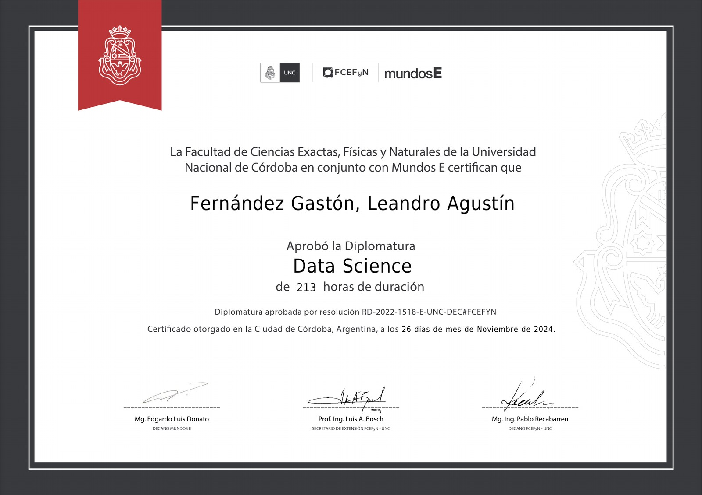

# Agustín Fernández Gastón

**Web & automation developer · Data analyst · Electronics technician**
 
Electronic Engineering student at UTN · La Rioja, Argentina

---

## About me

I work across the whole stack, from the circuit board to the dashboard. That means I can fix the device, build the software around it, and measure whether it works.

- **Software:** I build websites, WhatsApp bots, and automations for businesses, using the tools they already rely on: WhatsApp, Google Sheets, and their existing site.
- **Data:** I hold a 213-hour Data Science diploma from the National University of Córdoba (UNC) and Mundos E and use R, Python, and Power BI to turn raw data into decisions.
- **Hardware:** I run my own electronics lab, where I diagnose and repair boards from phones, TVs, air conditioners, and refrigerators. 30+ successful repairs. I'm also a certified refrigeration technician.

---

## What I can do for you

| Service | Typical deliverables |
|---|---|
| **Websites** | Business sites and landing pages, mobile-first, on your own domain, with automatic publishing from GitHub |
| **Bots & automation** | WhatsApp appointment and inquiry bots, form-to-spreadsheet flows, scheduled reports, repetitive tasks taken off people's hands |
| **Data & dashboards** | Data cleaning, exploratory analysis, statistical testing, and Power BI or R dashboards for sales, operations, and trends |
| **Electronics repair** | Board-level diagnosis and repair of phones, TVs, home appliances, and HVAC/refrigeration control boards |
| **IoT & embedded** | ESP32 sensor projects to measure and control physical processes (irrigation, temperature, energy) |

---

## Skills

### Web development

- Static and server-rendered sites with Next.js, responsive layouts, Canvas animation, bilingual (i18n) pages
- SEO basics: metadata, Open Graph, structured data, installable web apps (manifest and icons)

### Automation & integrations

- Conversational flows with guided menus (specialty → doctor → date and time), logging requests to spreadsheets
- Connecting messaging, forms, and spreadsheets without heavy infrastructure

### Cloud, hosting & DevOps

- Cloudflare Pages deployments with automatic builds on every push, custom domains and subdomains
- Domain registration (NIC Argentina), DNS delegation, CNAME setup, and HTTPS

### Data & analytics

- R: tidyverse, dplyr, ggplot2, vcd, nortest
- Python: pandas, NumPy, matplotlib
- Power BI: DAX, star-schema modeling, interactive dashboards, natural-language Q&A
- Statistics: EDA, chi-square tests, Cramér's V, contingency tables, normality tests, regression
- Data cleaning and automation with Excel and VBA

### Electronics & hardware

- SMD micro-soldering and hot-air rework on phone and consumer boards
- Board-level fault finding: voltage and current measurement, short-circuit isolation, schematic and boardview reading
- Repair of phones, TVs (main boards, power supplies, T-CON), home appliances, and HVAC/refrigeration control boards
- Refrigeration systems: certified technician, refrigeration cycle and diagnostics
- Embedded firmware for ESP32 and Arduino in C/C++ with PlatformIO: sensors, relays, non-blocking control loops

---

## Featured projects

| Project | What it does | Stack | Link |
|---|---|---|---|
| **Aviat Clinic website** | Website proposal for a surgical center: services, specialties, facilities, and WhatsApp contact. Auto-deployed from GitHub. | Next.js · TypeScript · Tailwind · Cloudflare Pages | [Live](https://aviat.riojadev.com.ar) · [Code](https://github.com/AgusFernandezGaston/aviat) |
| **WhatsApp appointment bot** | Patients pick specialty, doctor, date, and time from a guided menu; every request is logged in Google Sheets for the admissions team. In production. | Botpress · WhatsApp Business API · Google Sheets | Demo on request |
| **riojadev.com.ar** | My portfolio: interactive oscilloscope hero, bilingual (ES/EN), installable as an app. | HTML · CSS · JavaScript · Canvas | [Live](https://riojadev.com.ar) · [Code](https://github.com/AgusFernandezGaston/agusfernandezgaston.github.io) |
| **Depression risk in Argentine students** | Risk behaviors vs. depression probability in 56,981 secondary students (EMSE 2018): chi-square tests, Cramér's V, contingency tables. | R · ggplot2 · VBA | Available on request |
| **Sales performance dashboard** | Star-schema model, KPI cards, 2016 vs. 2017 comparison, natural-language Q&A. | Power BI · DAX | Demo on request |
| **ESP32 automatic irrigation** | Weather and soil-moisture sensors decide when to water and drive a pump through a relay. In development. | ESP32 · C++ · PlatformIO | Coming soon |

---

## The lab

Hot-air rework station, temperature-controlled soldering iron, bench power supply, USB microscope, and multimeter on an ESD mat.

---

## Education & certifications

| | Program | Institution | Details |
|---|---|---|---|
| 🎓 | **Data Science diploma** | Universidad Nacional de Córdoba (FCEFyN) & Mundos E | 213 hours · Completed November 2024 · Resolution RD-2022-1518-E-UNC-DEC#FCEFYN |
| 📐 | **Electronic Engineering** | Universidad Tecnológica Nacional (UTN), La Rioja | In progress |
| ❄️ | **Refrigeration technician** | Certified | Refrigeration cycle, diagnostics, and control boards |

<b>View Data Science diploma</b>

 

---

## Contact

I'm open to remote freelance work in web development, automation, and data, and to local electronics work in La Rioja.

The fastest way to reach me is through [LinkedIn](https://www.linkedin.com/in/agustin-fernandez-ingenieria/) or the contact section at [riojadev.com.ar](https://riojadev.com.ar).
