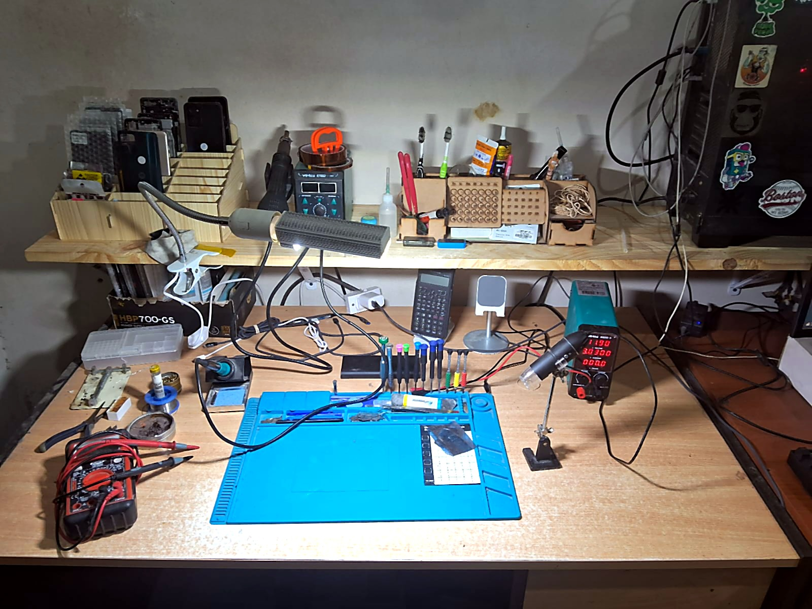

# Agustín Fernández Gastón

**Web & automation developer · Data analyst · Electronics technician**
 
Electronic Engineering student at UTN · La Rioja, Argentina

[riojadev.com.ar](https://riojadev.com.ar) · [LinkedIn](https://www.linkedin.com/in/agustin-fernandez-ingenieria/) · [Live projects](#featured-projects)

---

## About me

I work across the whole stack, from the circuit board to the dashboard.

- **Software:** I build websites, WhatsApp bots, and automations for businesses, using the tools they already rely on: WhatsApp, Google Sheets, their existing site.
- **Data:** I trained in Data Science at Mundos E (Córdoba) and use R, Python, and Power BI to turn raw data into decisions.
- **Hardware:** I run my own electronics lab, where I diagnose and repair boards from phones, TVs, air conditioners, and refrigerators. 30+ successful repairs. I'm also a certified refrigeration technician.

I'm open to remote freelance work in web development, automation, and data, and to local electronics work in La Rioja.

---

## Featured projects

| Project | What it does | Stack | Link |
|---|---|---|---|
| **Aviat Clinic website** | Website proposal for a surgical center: services, specialties, facilities, and WhatsApp contact. Auto-deployed from GitHub. | Next.js · TypeScript · Tailwind · Cloudflare Pages | [Live](https://aviat.riojadev.com.ar) · [Code](https://github.com/AgusFernandezGaston/aviat) |
| **WhatsApp appointment bot** | Patients pick specialty, doctor, date, and time from a guided menu; every request is logged in Google Sheets for the admissions team. In production. | Botpress · WhatsApp Business API · Google Sheets | Demo on request |
| **riojadev.com.ar** | My portfolio: interactive oscilloscope hero, bilingual (ES/EN), installable as an app. | HTML · CSS · JavaScript · Canvas | [Live](https://riojadev.com.ar) · [Code](https://github.com/AgusFernandezGaston/agusfernandezgaston.github.io) |
| **Depression risk in Argentine students** | Risk behaviors vs. depression probability in 56,981 secondary students (EMSE 2018): chi-square tests, Cramér's V, contingency tables. | R · ggplot2 · VBA | [Repositories](https://github.com/AgusFernandezGaston?tab=repositories) |
| **Sales performance dashboard** | Star-schema model, KPI cards, 2016 vs. 2017 comparison, natural-language Q&A. | Power BI · DAX | Demo on request |
| **ESP32 automatic irrigation** | Weather and soil-moisture sensors decide when to water and drive a pump through a relay. In development. | ESP32 · C++ · PlatformIO | Coming soon |

---

## Tech stack

**Web & automation**
Next.js · TypeScript · HTML/CSS/JavaScript · Tailwind · Framer · Botpress · Google Apps Script · Cloudflare (Pages, Workers, DNS) · Git & GitHub

**Data & analytics**
R (tidyverse, ggplot2, vcd, nortest) · Python (pandas, NumPy, matplotlib) · Power BI (DAX, star schema) · Excel / VBA · Statistical modeling, EDA, regression

**Hardware & electronics**
SMD micro-soldering · Board-level diagnostics (consumer electronics, HVAC, refrigeration) · ESP32 / Arduino · C/C++ · Bench power supply, multimeter, and oscilloscope work

---

## The lab

Rework station, temperature-controlled soldering iron, bench power supply, USB microscope, and multimeter on an ESD mat.

---

## GitHub stats

  
  

---

## Contact

The fastest way to reach me is through [LinkedIn](https://www.linkedin.com/in/agustin-fernandez-ingenieria/) or the contact section at [riojadev.com.ar](https://riojadev.com.ar).
